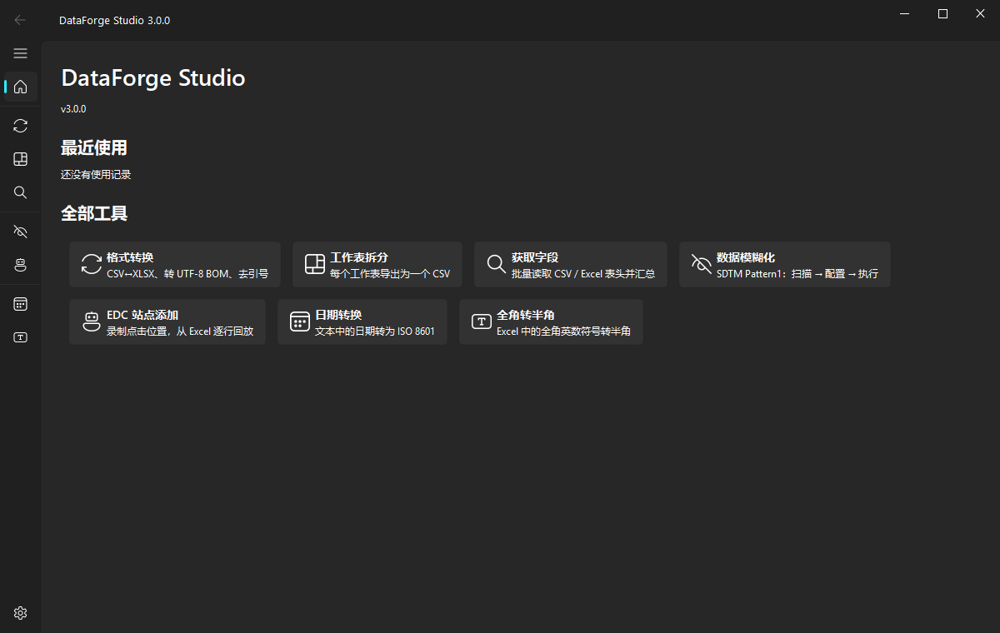
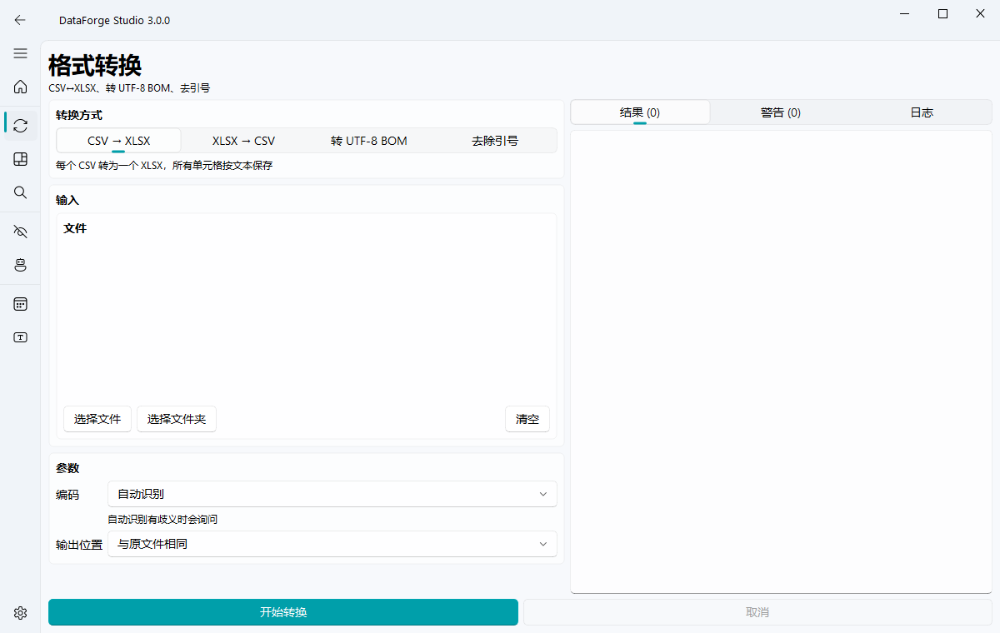

[English](README.md) | [中文](README_CN.md)

<div align="center">


**A Windows desktop data toolbox that gathers everyday repetitive chores — CSV / Excel format conversion, SDTM data masking, batch EDC site entry and more — into one window.**

[Overview](#overview) • [Tools](#tools) • [Screenshots](#screenshots) • [Getting Started](#getting-started) • [Packaging](#packaging) • [Documentation](#documentation)

</div>

---

## Overview

**DataForge Studio** is a Windows desktop toolbox built with PySide6 and QFluentWidgets. The current version is **3.0.0**, a full rewrite that keeps the 7 tools from 2.x and reorganizes the UI, background execution and processing rules.

`tools_box` is the repository name; `DataForge Studio` is the product name.

**Highlights:**
- 🎨 **Follows your system theme**: light / dark follows the Windows setting by default; you can also pick Light or Dark on the Settings page
- 🧰 **7 focused tools**: grouped as File Processing, Business and Utilities in the left navigation
- 🛡️ **Safe by default**: output goes to new files; originals are only overwritten after you tick "Overwrite original" and confirm
- 🔤 **Predictable encoding**: CSV is always written as UTF-8 with BOM (`utf-8-sig`); input encoding is detected automatically
- ⚡ **Responsive UI**: long-running work runs in the background with progress and a Cancel button
- 🕘 **Recent items**: the home page lists recently used tools and restores their inputs and parameters
- 📦 **Packaged build**: onedir program plus an Inno Setup installer, with a built-in `--self-check`

---

## Tools

| Group | Tool | What it does | Rule doc |
| --- | --- | --- | --- |
| File Processing | Format Convert | CSV to XLSX, XLSX to CSV, CSV to UTF-8 BOM, strip CSV quotes | [format_convert.md](docs/tools/format_convert.md) |
| File Processing | Sheet Split | Export each worksheet of an Excel workbook to its own CSV | [sheet_split.md](docs/tools/sheet_split.md) |
| File Processing | Field Extract | Read the headers of many CSV / Excel files and collect them into one list | [field_extract.md](docs/tools/field_extract.md) |
| Business | Data Masking | SDTM Pattern1: scan → configure → run, producing masked data for testing | [masking.md](docs/tools/masking.md) |
| Business | EDC Site Adder | Record click positions in the browser, then replay them row by row with site numbers read from Excel | [edc_site_adder.md](docs/tools/edc_site_adder.md) |
| Utilities | Date Convert | Convert `YYYY/MM[/DD]` dates in text to ISO 8601 | [date_convert.md](docs/tools/date_convert.md) |
| Utilities | Full-width to Half-width | Convert full-width letters, digits and symbols in Excel to half-width, keeping formatting and formulas | [width_convert.md](docs/tools/width_convert.md) |

Input requirements, parameter defaults, output naming, encoding rules and known limitations for each tool are defined in the rule docs under `docs/tools/`; this page does not repeat them. See [docs/tools/README.md](docs/tools/README.md) for how rule docs and golden samples are written.

### Shared conventions

- 📄 Output goes to a new file by default; if the target exists, `_1`, `_2`, … is appended.
- ✅ The original file is rewritten only when you tick "Overwrite original" and confirm the dialog.
- 🔤 CSV is always written as UTF-8 with BOM (`utf-8-sig`).
- 🔍 CSV input encoding is detected automatically; when a file decodes as both Japanese cp932 and Chinese GBK, you get a preview of each and choose.

---

## Screenshots

<details open>
<summary><strong>Home (light)</strong></summary>


</details>

<details>
<summary><strong>Home (dark)</strong></summary>



</details>

<details>
<summary><strong>Format Convert</strong></summary>



</details>

<details>
<summary><strong>Data Masking (dark)</strong></summary>


</details>

<details>
<summary><strong>EDC Site Adder</strong></summary>


</details>

---

## Getting Started

### Install (no Python needed)

Download `DataForgeStudio-Setup-3.0.0.exe` from the [latest release](https://github.com/hakupao/tools_box/releases/latest) and run it. It installs to `%LOCALAPPDATA%\Programs\DataForgeStudio` without administrator rights. The sections below are only needed to run from source.

### Requirements

- **Windows 10 / 11**
- **Python 3.11+** (verified on 3.13; the minimum is 3.11, see `requires-python` in `pyproject.toml`)

### Run from source

From the repository root:

```powershell
python -m venv .venv
.venv\Scripts\python -m pip install -r requirements-dev.txt
.venv\Scripts\python -m pip install -e .
.venv\Scripts\python -m dataforge
```

`pip install -e .` installs `src/dataforge` into the virtual environment in editable mode; both `python -m dataforge` and the packaging scripts rely on it.

### Run the tests

```powershell
.venv\Scripts\python -m pytest tests -q
```

The suite covers unit tests for each tool, comparison tests against the golden samples in `tests/golden/`, and smoke tests of every page in both light and dark themes. UI tests run offscreen, so no windows pop up.

---

## Packaging

Complete "Run from source" first. All three scripts live in `packaging/scripts/`:

```powershell
# 1. Build the onedir program folder and run the packaging self-check
powershell -ExecutionPolicy Bypass -File .\packaging\scripts\build_onedir.ps1 -Clean

# 2. Build the installer (requires Inno Setup 6)
powershell -ExecutionPolicy Bypass -File .\packaging\scripts\build_installer.ps1 -Clean

# 3. Measure startup time
powershell -ExecutionPolicy Bypass -File .\packaging\scripts\measure_startup.ps1
```

| Output | Location |
| --- | --- |
| Program | `dist\DataForgeStudio\DataForgeStudio.exe` |
| Installer | `dist_installer\DataForgeStudio-Setup-3.0.0.exe` |

Self-check: `DataForgeStudio.exe --self-check` (from source: `.venv\Scripts\python -m dataforge --self-check`). Parameters, the self-check and upgrade installs are described in [packaging/README.md](packaging/README.md).

---

## Configuration & Logs

The exact paths come from platformdirs; typically:

| Item | Location |
| --- | --- |
| Config file | `%LOCALAPPDATA%\dataforge_studio\dataforge_studio_config.json` |
| Logs | `%LOCALAPPDATA%\dataforge_studio\Logs\dataforge.log` (rotating, up to 4 files) |

The Settings page has "Open config folder" and "Open log folder" buttons. Set the environment variable `DATAFORGE_STUDIO_CONFIG_PATH` to use a different config file.

If the config file is corrupted, the app first backs it up as `dataforge_studio_config.json.corrupt-<timestamp>.bak` in the same folder, then continues with defaults.

---

## Upgrading from v2

- 🔁 Run the 3.0.0 installer (from the [latest release](https://github.com/hakupao/tools_box/releases/latest)) over the existing installation; there is no need to uninstall first.
- ⚙️ Settings carry over: the unified 2.x config file location is unchanged (`%LOCALAPPDATA%\dataforge_studio\dataforge_studio_config.json`) and is read directly at startup. The 1.x file `%LOCALAPPDATA%\tools_box\tools_box_config.json` is used as a fallback when the new file does not exist. Separate Data Masking / EDC config files next to the program (or in an old source folder) are read the first time the corresponding tool is opened; masking profiles and EDC click positions are kept.
- 🖱️ Old EDC configs have no "target window"; record once, or pick the target window on the page, before the first run.
- 🗑️ Removed in v3: the 仕様書 (spec) workflow (DataSet generation, data cleaning, Codelist processing), the dead-link checker, and the Data Masking Pattern2 placeholder page.
- 🎨 The theme now follows the system, with a manual Light / Dark choice on the Settings page.

See [CHANGELOG.md](CHANGELOG.md) for the full list of changes.

---

## About the Python Version

This Python version is a transition release; the app will later be rewritten in C# or Rust. To support that, every tool has:

- 📘 a language-neutral rule doc: `docs/tools/<tool>.md`;
- 🧪 a set of golden samples: `tests/golden/<tool>/<case>/`, containing input files, a parameter JSON and the expected output.

The new implementation will follow the rule docs and be accepted against the same golden samples.

---

## Documentation

| Document | Description |
| --- | --- |
| [docs/用户手册.md](docs/用户手册.md) | User manual |
| [docs/开发文档.md](docs/开发文档.md) | Developer guide |
| [docs/API文档.md](docs/API文档.md) | API reference |
| [docs/UI界面规范.md](docs/UI界面规范.md) | UI guidelines |
| [docs/tools/](docs/tools/README.md) | Per-tool rule docs |
| [packaging/README.md](packaging/README.md) | Packaging notes |
| [CHANGELOG.md](CHANGELOG.md) | Changelog |

The detailed documents are written in Chinese.

---

<div align="center">

**[⬆ Back to Top](#overview)**

</div>
