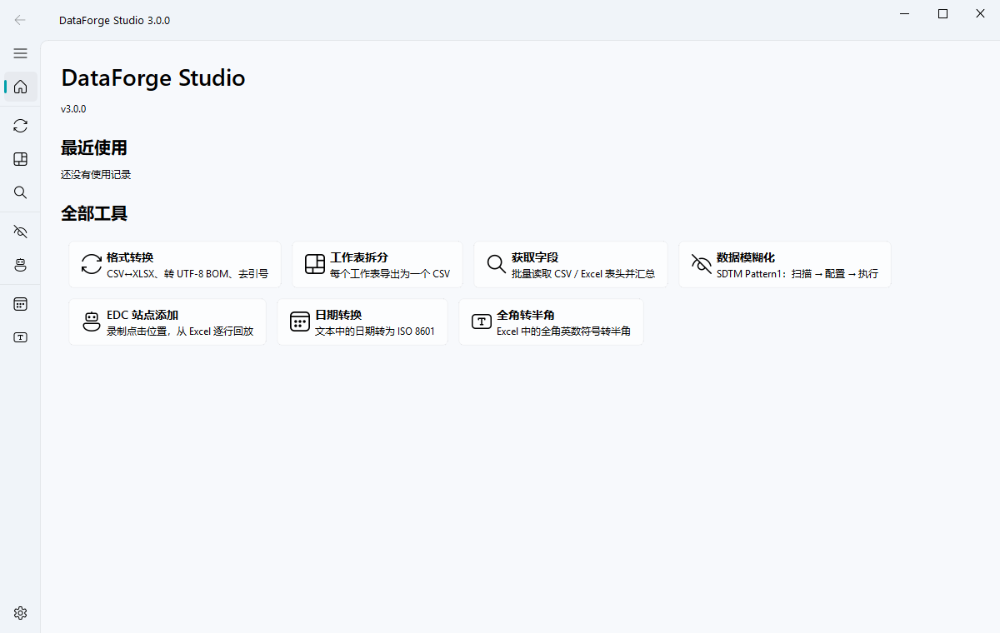
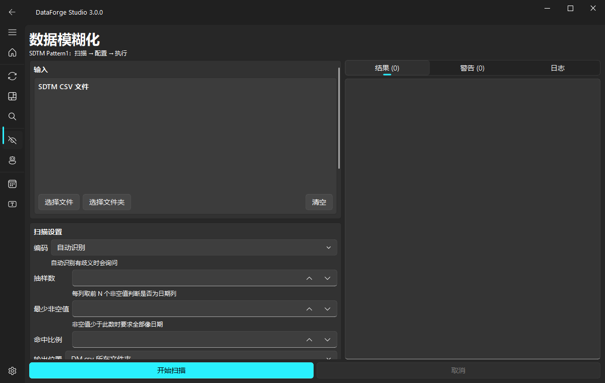
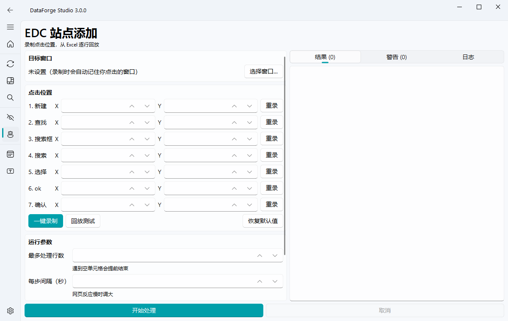

# DataForge Studio

DataForge Studio 是一个 Windows 桌面数据工具箱，把 CSV / Excel 格式转换、SDTM 数据模糊化、EDC 站点批量添加等日常重复操作收在一个窗口里。当前版本 3.0.0。

`tools_box` 是仓库名，`DataForge Studio` 是产品名。




| 格式转换 | 数据模糊化（深色） | EDC 站点添加 |
| --- | --- | --- |
|  |  |  |

## 工具一览

| 分组 | 工具 | 用途 | 规则说明 |
| --- | --- | --- | --- |
| 文件处理 | 格式转换 | CSV 转 XLSX、XLSX 转 CSV、CSV 转 UTF-8 BOM、CSV 去引号 | [format_convert.md](docs/tools/format_convert.md) |
| 文件处理 | 工作表拆分 | Excel 的每个工作表导出为一个 CSV | [sheet_split.md](docs/tools/sheet_split.md) |
| 文件处理 | 获取字段 | 批量读取 CSV / Excel 的表头，汇总成一份清单 | [field_extract.md](docs/tools/field_extract.md) |
| 业务 | 数据模糊化 | SDTM Pattern1：扫描 → 配置 → 执行，生成可用于测试的模糊化数据 | [masking.md](docs/tools/masking.md) |
| 业务 | EDC 站点添加 | 录制浏览器里的点击位置，再从 Excel 逐行读取站点编号自动点击 | [edc_site_adder.md](docs/tools/edc_site_adder.md) |
| 小工具 | 日期转换 | 把文本里的 `YYYY/MM[/DD]` 转成 ISO 8601 | [date_convert.md](docs/tools/date_convert.md) |
| 小工具 | 全角转半角 | Excel 中的全角英文、数字和符号转为半角，保留格式和公式 | [width_convert.md](docs/tools/width_convert.md) |

每个工具的输入要求、参数默认值、输出命名、编码规则和已知限制，都以 `docs/tools/` 下的规则说明为准，本页不再重复。规则说明的写法和标准样例的格式见 [docs/tools/README.md](docs/tools/README.md)。

所有工具都遵守同一套约定：

- 默认输出新文件，不覆盖原文件；目标文件已存在时自动加 `_1`、`_2`……
- 只有勾选"覆盖原文件"并在弹窗中确认后，才会改写原文件。
- CSV 一律以 UTF-8 BOM（`utf-8-sig`）写出。
- 读取 CSV 时自动识别编码；日文 cp932 和中文 GBK 都能解码时，会让你看预览后再选。

## 运行环境

- Windows 10 / 11
- Python 3.11 及以上（已在 3.13 上验证；最低支持版本为 3.11，见 `pyproject.toml` 的 `requires-python`）

## 从源码运行

在仓库根目录执行：

```powershell
python -m venv .venv
.venv\Scripts\python -m pip install -r requirements-dev.txt
.venv\Scripts\python -m pip install -e .
.venv\Scripts\python -m dataforge
```

`pip install -e .` 把 `src/dataforge` 以可编辑方式安装到虚拟环境，`python -m dataforge` 和打包脚本都依赖它。

## 运行测试

```powershell
.venv\Scripts\python -m pytest tests -q
```

测试包括各工具的单元测试、`tests/golden/` 下标准样例的对照测试，以及每个页面在亮色、暗色主题下的冒烟测试。界面测试使用 offscreen 模式，不会弹出窗口。

## 打包

需要先完成"从源码运行"中的安装。三个脚本都在 `packaging/scripts/` 下：

```powershell
# 1. 生成 onedir 程序目录，并运行打包自检
powershell -ExecutionPolicy Bypass -File .\packaging\scripts\build_onedir.ps1 -Clean

# 2. 生成安装包（需要 Inno Setup 6）
powershell -ExecutionPolicy Bypass -File .\packaging\scripts\build_installer.ps1 -Clean

# 3. 测量启动时间
powershell -ExecutionPolicy Bypass -File .\packaging\scripts\measure_startup.ps1
```

产物位置：

- 程序：`dist\DataForgeStudio\DataForgeStudio.exe`
- 安装包：`dist_installer\DataForgeStudio-Setup-3.0.0.exe`

参数、自检和覆盖安装的说明见 [packaging/README.md](packaging/README.md)。

## 配置和日志位置

两者的具体路径由 platformdirs 决定，一般是：

| 内容 | 位置 |
| --- | --- |
| 配置文件 | `%LOCALAPPDATA%\dataforge_studio\dataforge_studio_config.json` |
| 日志 | `%LOCALAPPDATA%\dataforge_studio\Logs\dataforge.log`（滚动保存，最多 4 个文件） |

设置页里有"打开配置文件夹"和"打开日志文件夹"两个按钮，可以直接打开。设置环境变量 `DATAFORGE_STUDIO_CONFIG_PATH` 可以改用另一份配置文件。

配置文件损坏时，程序会先把它备份为同目录下的 `dataforge_studio_config.json.corrupt-<时间>.bak`，再用默认值继续运行。

## 从 v2 升级

- 直接运行 3.0.0 安装包覆盖安装即可，不用先卸载。
- 配置会自动沿用：2.x 的统一配置文件位置没有变（`%LOCALAPPDATA%\dataforge_studio\dataforge_studio_config.json`），启动时直接读取；更早版本（1.x）用的 `%LOCALAPPDATA%\tools_box\tools_box_config.json` 在新文件不存在时作为后备读取。程序目录旁边（或旧源码目录里）单独的数据模糊化、EDC 配置文件，在第一次打开对应工具时读入。数据模糊化的配置档和 EDC 的点击位置都会保留。
- EDC 的旧配置里没有"目标窗口"，第一次运行前需要录制一次，或者在页面上选择目标窗口。
- 仕様書工作流（生成 DataSet、数据清洗、Codelist 处理）和死链检测已经移除，数据模糊化 Pattern2 的占位页也已移除。
- 程序不再依赖 pandas；主题改为跟随系统，也可以在设置页手动选择浅色或深色。

完整变化见 [CHANGELOG.md](CHANGELOG.md)。

## 关于 Python 版

这个 Python 版是过渡版本，之后会用 C# 或 Rust 重写。为此每个工具都有：

- 一份与编程语言无关的规则说明：`docs/tools/<工具>.md`；
- 一组标准样例：`tests/golden/<工具>/<样例>/`，包含输入文件、参数 JSON 和期望输出。

新版本按规则说明实现，再用同一组标准样例对照验收。

## 文档

- [用户手册](docs/用户手册.md)
- [开发文档](docs/开发文档.md)
- [API 文档](docs/API文档.md)
- [界面规范](docs/UI界面规范.md)
- [工具规则说明](docs/tools/README.md)
- [打包说明](packaging/README.md)
- [更新日志](CHANGELOG.md)
