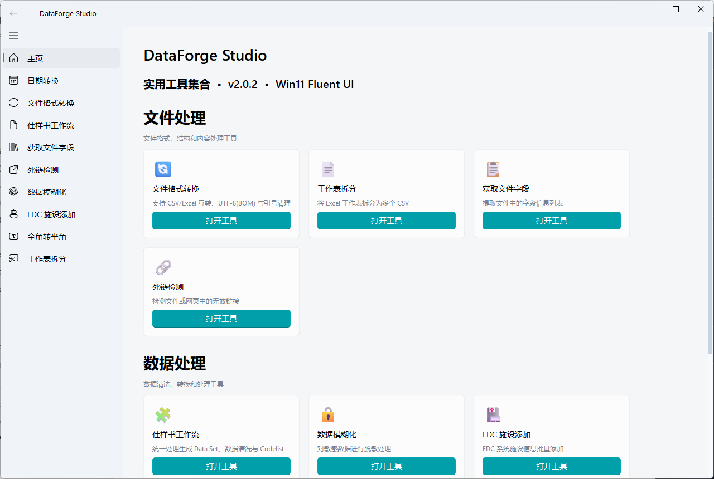
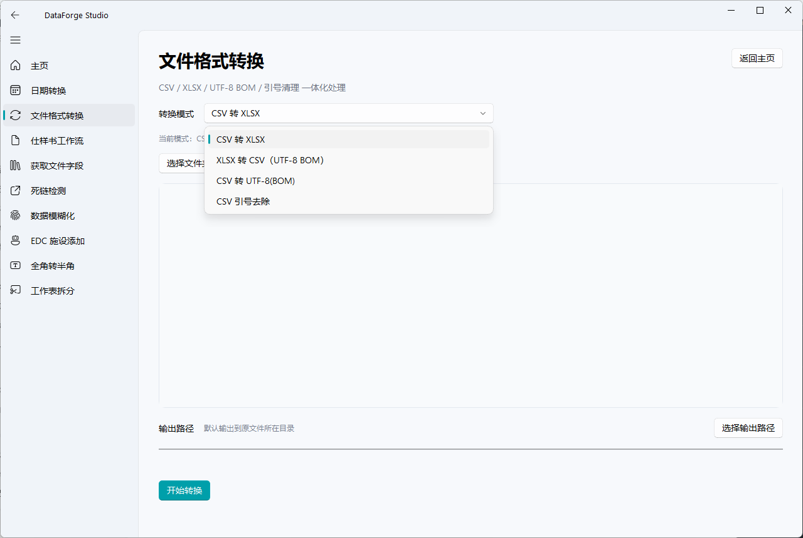
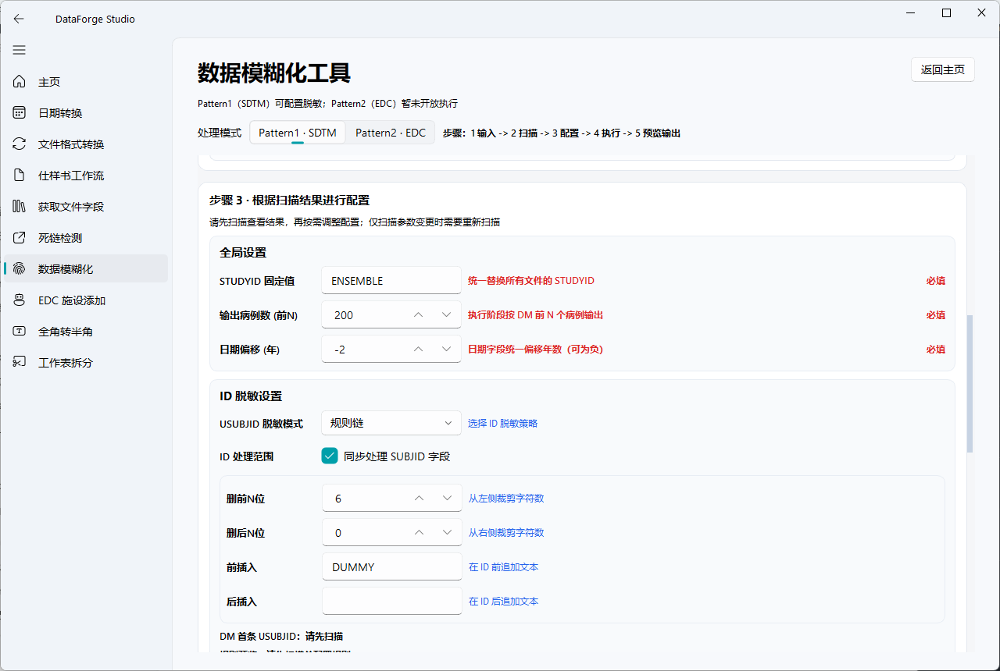
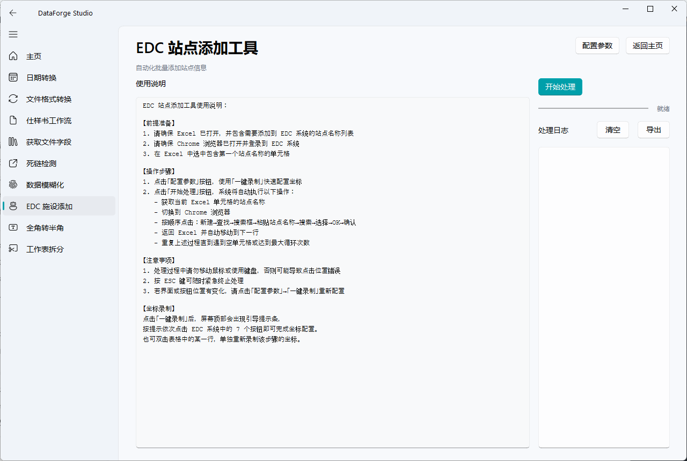

[English](README.md) | [中文](README_CN.md)

<div align="center">


**用于 SDTM 数据处理的 Windows 桌面工具箱，具有 Fluent Design UI。格式转换、数据清洗、掩码、提取和批量工具全部集于一个工作室中。**

[功能](#功能) • [快速开始](#快速开始) • [用户指南](#用户指南) • [工具](#工具) • [架构](#架构)

</div>

---


### 界面截图

<details open>
<summary><strong>主页概览</strong></summary>



</details>

<details>
<summary><strong>格式转换</strong></summary>



</details>

<details>
<summary><strong>数据模糊化</strong></summary>



</details>

<details>
<summary><strong>EDC 站点添加</strong></summary>



</details>

---

## 项目概述

**DataForge Studio**（工具箱）是一套为处理 SDTM 和临床试验数据集的数据专业人士量身定制的综合 Windows 桌面应用程序。采用 PySide6 和 QFluentWidgets 构建，提供原生 Windows 11 Fluent Design 界面和强大的数据处理能力。

**主要优势：**
- 🎨 **Windows 11 Fluent Design**：原生现代 UI，流畅动画和深色/浅色模式
- 📊 **SDTM 导向**：专为临床数据处理的专业工具
- 🔧 **格式转换**：Excel ↔ CSV ↔ SAS ↔ Parquet
- 🧹 **数据清洗**：缺失值处理、去重、异常值检测
- 🔐 **数据掩码**：PII 匿名化、字段加密、值混淆
- 📋 **字段提取**：模式匹配、子集选择、字段映射
- ⚙️ **批量工具**：多文件处理、自动化脚本
- 📦 **PyInstaller 构建**：为 Windows 提供即开即用的 .exe 可执行文件

---

## 关键功能

| 功能 | 说明 |
|------|------|
| 🎨 **Fluent UI** | Windows 11 Fluent Design System，支持深色/浅色主题 |
| 📦 **格式转换** | XLSX ↔ CSV ↔ SAS ↔ Parquet，支持编码转换 |
| 🧹 **数据清洗** | 去除重复项、处理缺失值、异常值检测 |
| 🔐 **数据掩码** | PII 保护、字段级加密、值哈希 |
| 📊 **字段提取** | 基于正则表达式的提取、字段映射、子集化 |
| 🔄 **批量处理** | 使用相同规则处理多个文件 |
| 📈 **统计分析** | 数据分析、质量指标、汇总报告 |
| 💾 **项目工作空间** | 保存/加载处理配置 |
| ⚡ **多线程** | 长时间操作期间 UI 不阻塞 |
| 📚 **帮助文档** | 集成帮助、用户手册、API 文档 |

---

## 架构设计

```mermaid
graph TB
 A[" 输入数据<br/>(XLSX/CSV/SAS/Parquet)"] -->|加载| B[" 数据加载器"]
 B --> C[" 主窗口<br/>(DataForge Studio)"]

 C -->|用户选择工具| D{[" 工具选择"]}

 D -->|格式| E[" 转换器<br/>(格式转换)"]
 D -->|清洗| F[" 清洁器<br/>(数据清洗)"]
 D -->|掩码| G[" 掩码器<br/>(PII 保护)"]
 D -->|提取| H[" 提取器<br/>(字段提取)"]
 D -->|批量| I["⚙ 批处理器<br/>(多文件)"]

 E -->|转换| J[" 输出数据"]
 F -->|清洁| J
 G -->|匿名化| J
 H -->|提取| J
 I -->|处理| J

 J -->|导出| K[" 保存<br/>(xlsx/csv/sas/parquet)"]

 style A fill:#e3f2fd
 style C fill:#c8e6c9
 style J fill:#fff9c4
 style K fill:#f0f4c3
```

### 组件架构

```
DataForge Studio
├── GUI 层（PySide6 + QFluentWidgets）
│   ├── 主窗口
│   ├── 工具选择面板
│   ├── 预览窗格
│   └── 状态/进度条
│
├── 工具层
│   ├── 转换器（格式转换）
│   ├── 清洁器（数据质量）
│   ├── 掩码器（PII 保护）
│   ├── 提取器（字段操作）
│   └── 批处理器（多文件）
│
├── 数据层（pandas/numpy）
│   ├── 数据加载器（多格式读取）
│   ├── 数据处理器（转换）
│   └── 数据导出器（多格式写入）
│
└── 配置层（JSON/TOML）
    ├── 项目配置
    ├── 工具预设
    └── 用户偏好
```

---

## 快速开始

### 前置条件

- **Windows 7 或更新版本**（推荐 Windows 11 以获得完整 Fluent Design）
- **Python 3.11+**
- **约 200 MB 磁盘空间**

### 安装

#### 选项 1：Python 安装（用于开发人员）

```bash
# 克隆代码库
git clone https://github.com/hakupao/tools_box.git
cd tools_box

# 创建虚拟环境
python -m venv venv
venv\Scripts\activate

# 安装依赖
pip install -e .

# 启动
python -m tools_box
```

#### 选项 2：独立 .exe（用于最终用户）

从 [发布版本](https://github.com/hakupao/tools_box/releases) 下载最新版本。

```bash
# 只需双击 DataForge_Studio.exe
# 无需安装 Python！
```

### 5 分钟快速上手

```
1. 启动 DataForge Studio
2. 点击"加载数据"→ 选择你的 CSV/Excel 文件
3. 从左面板选择工具：
   - 格式转换
   - 数据清洗
   - 数据掩码
   - 字段提取
   - 批量处理
4. 在工具面板中配置选项
5. 点击"处理"或"预览"
6. 通过"另存为"导出结果
```

---

## 用户指南

### 加载数据

1. **文件菜单** → **打开**或拖放文件
2. 支持的格式：`XLSX`、`CSV`、`SAS7BDAT`、`Parquet`
3. 自动检测编码；如需要可覆盖
4. 预览显示前 100 行

### 格式转换

**在数据格式之间转换：**

```
XLSX → CSV          Excel 转逗号分隔值
CSV → XLSX          CSV 转 Excel 工作簿
CSV → SAS           CSV 转 SAS 数据集
Parquet → CSV      Parquet 转 CSV
```

**选项：**
- 分隔符（,、;、\t、|）
- 编码（utf-8、latin1、cp1252 等）
- 小数分隔符（.、,）
- 工作表选择（用于 XLSX）

### 数据清洗

**移除数据质量问题：**

- **去除重复**：精确或模糊匹配
- **处理缺失值**：删除行、向前填充、均值插补
- **异常值检测**：IQR 方法、z-score 方法
- **数据类型更正**：自动检测和转换类型
- **修剪空格**：移除前导/末尾空格

**配置：**
```json
{
  "duplicates": {
    "enabled": true,
    "method": "exact",
    "subset": ["USUBJID", "VISIT"]
  },
  "missing": {
    "method": "delete_row",
    "threshold": 0.5
  },
  "outliers": {
    "detect": true,
    "method": "iqr",
    "action": "flag"
  }
}
```

### 数据掩码

**保护 PII 和敏感信息：**

- **字段掩码**：替换值（例如，姓名 → "XXX"）
- **哈希**：SHA-256 散列敏感字段
- **加密**：AES-256 字段加密
- **日期偏移**：向日期添加随机天数
- **值混淆**：洗牌/随机化值

**示例：**
```json
{
  "fields_to_mask": {
    "SUBJID": "hash",
    "FNAME": "replace",
    "LNAME": "replace",
    "DOB": "date_shift",
    "ADDRESS": "encryption"
  },
  "encryption_key": "use-key-from-vault"
}
```

### 字段提取

**提取和操作特定字段：**

- **正则提取**：模式匹配（例如，提取区号）
- **列选择**：保留/删除特定列
- **字段映射**：重命名列
- **计算字段**：从公式创建新字段
- **值替换**：查找和替换值

**示例：**
```
从电话号码中提取区号
模式：(\d{3})-\d{3}-\d{4}
替换：$1
结果："555-123-4567" → "555"
```

### 批量处理

**使用相同的规则处理多个文件：**

1. **选择工具**（格式转换、清洗等）
2. **选择输入文件夹**（所有匹配的文件）
3. **配置工具选项**
4. **点击"开始批处理"**
5. 每个文件显示进度
6. 所有结果保存到输出文件夹

---

## 工具概览

### 格式转换器
在 Excel、CSV、SAS、Parquet 之间转换，完全控制编码和分隔符。

### 数据清洁器
去除重复项、处理缺失值、检测异常值、自动纠正数据类型。

### 数据掩码器
通过掩码、哈希、加密和日期偏移匿名化 PII。

### 字段提取器
提取模式、选择列、创建计算字段、映射/重命名列。

### 批处理器
将任何工具应用于多个文件，带有进度跟踪。

---

## 项目结构

<details>
<summary><b>📁 完整目录布局</b></summary>

```
tools_box/
│
├── 📄 README.md & README_CN.md
├── 📄 pyproject.toml           # Python 项目配置
├── 📄 requirements.txt
├── 📄 CHANGELOG.md
│
├── 🎨 tools_box/（包）
│   ├── __main__.py             # 入口点
│   ├── __init__.py
│   ├── main_window.py          # 主 GUI 窗口
│   ├── config.py               # 配置管理
│   │
│   ├── gui/
│   │   ├── main_panel.py       # 主工作区
│   │   ├── tool_selector.py    # 工具选择面板
│   │   ├── preview_pane.py     # 数据预览
│   │   ├── status_bar.py       # 状态和进度
│   │   ├── dialogs.py          # 文件对话框、设置
│   │   └── styles.css          # Fluent Design 样式
│   │
│   ├── tools/
│   │   ├── base_tool.py        # 基础工具类
│   │   ├── converter.py        # 格式转换
│   │   ├── cleaner.py          # 数据清洗
│   │   ├── masker.py           # 数据掩码
│   │   ├── extractor.py        # 字段提取
│   │   └── batch_processor.py  # 批量操作
│   │
│   ├── data/
│   │   ├── loader.py           # 多格式数据加载
│   │   ├── processor.py        # 数据转换
│   │   ├── exporter.py         # 多格式导出
│   │   └── validator.py        # 数据验证
│   │
│   ├── utils/
│   │   ├── crypto.py           # 加密工具
│   │   ├── regex.py            # 模式匹配
│   │   ├── hash.py             # 哈希函数
│   │   └── logging.py          # 日志设置
│   │
│   └── resources/
│       ├── icons/
│       ├── themes/
│       └── config_templates/
│
├── 📚 docs/
│   ├── 用户手册.md             # 用户手册（中文）
│   ├── API文档.md              # API 文档
│   ├── 开发文档.md             # 开发指南
│   ├── QUICK_START.md
│   └── assets/
│       ├── gui_screenshot.png
│       └── tutorial.md
│
├── 📦 packaging/
│   ├── pyinstaller_config.spec # PyInstaller 配置
│   ├── build_executable.py     # 构建脚本
│   └── installer_config.nsi    # NSIS 安装程序
│
└── ✅ tests/
    ├── test_converter.py
    ├── test_cleaner.py
    ├── test_masker.py
    ├── test_extractor.py
    └── test_batch_processor.py
```

</details>

---

## 高级用法

<details>
<summary><b>🎛️ 自定义工具开发</b></summary>

通过扩展 `BaseTool` 创建自定义工具：

```python
from tools_box.tools.base_tool import BaseTool

class MyCustomTool(BaseTool):
    def __init__(self):
        super().__init__(
            name="My Custom Tool",
            description="Does something useful"
        )

    def process(self, dataframe, **options):
        # 你的处理逻辑
        df = dataframe.copy()
        # ... 转换代码 ...
        return df

    def get_options_ui(self):
        # 返回 QWidget 选项 UI
        pass
```

</details>

<details>
<summary><b>🤖 自动化脚本</b></summary>

通过 Python API 运行 DataForge Studio：

```python
from tools_box.data.loader import DataLoader
from tools_box.tools.converter import Converter

# 加载数据
loader = DataLoader()
df = loader.load("input.xlsx")

# 转换格式
converter = Converter()
result = converter.process(
    df,
    input_format="xlsx",
    output_format="csv",
    encoding="utf-8"
)

# 导出
loader.save(result, "output.csv")
```

</details>

<details>
<summary><b>🔐 加密密钥管理</b></summary>

保护加密密钥：

```python
import os
from tools_box.utils.crypto import EncryptionManager

# 从环境变量加载密钥（推荐）
key = os.environ.get("DATAFORGE_ENCRYPTION_KEY")

manager = EncryptionManager(key)
encrypted_data = manager.encrypt("sensitive_value")
decrypted_data = manager.decrypt(encrypted_data)
```

</details>

---

## 依赖包

```
PySide6>=6.5              # Qt GUI 框架
QFluentWidgets>=0.4.4    # Fluent Design UI 组件
pandas>=2.0              # 数据操作
numpy>=1.21              # 数值运算
openpyxl>=3.0            # Excel I/O
pyarrow>=10.0            # Parquet 支持
cryptography>=38.0       # 加密
```

---

## 构建可执行文件

### 使用 PyInstaller

```bash
# 安装构建依赖
pip install pyinstaller

# 构建可执行文件
python packaging/build_executable.py

# 输出：dist/DataForge_Studio.exe
```

### 创建安装程序

```bash
# 安装 NSIS（Nullsoft 安装系统）
# 从 https://nsis.sourceforge.io/ 下载

# 构建安装程序
makensis packaging/installer_config.nsi

# 输出：dist/DataForge_Studio_Installer.exe
```

---

## 配置和设置

### 用户设置（JSON）

位置：`%APPDATA%/DataForge Studio/config.json`

```json
{
  "theme": "dark",
  "language": "zh",
  "recent_files": [
    "C:/Data/file1.csv",
    "C:/Data/file2.xlsx"
  ],
  "tool_presets": {
    "cleaning": {
      "remove_duplicates": true,
      "handle_missing": "delete"
    }
  }
}
```

---

## 性能提示

- 📊 **大文件**：使用 Parquet 格式以获得更好的性能
- 🔄 **批量处理**：以 100-1000 个文件的批次处理文件
- 💾 **内存**：处理大于 500 MB 的文件时监控 RAM
- 🚀 **多线程**：处理期间 UI 保持响应
- 📈 **优化**：为重复操作启用缓存

---

## 故障排除

<details>
<summary><b>常见问题</b></summary>

| 问题 | 解决方案 |
|------|--------|
| 文件无法打开 | 检查编码，尝试自动检测 |
| 数据显示为损坏 | 验证文件格式，检查分隔符 |
| GUI 在处理时冻结 | 等待操作完成（检查任务栏） |
| 内存不足错误 | 分块处理文件或使用 Parquet |
| 加密密钥丢失 | 在安全保管库中保留备份（例如 Azure Key Vault） |

</details>

---

## 贡献

欢迎贡献！见 [CONTRIBUTING.md](CONTRIBUTING.md)。

```bash
# 开发设置
git clone https://github.com/hakupao/tools_box.git
cd tools_box
pip install -e ".[dev]"
pytest tests/
```

---

## 路线图

- [ ] 数据库连接器（SQL Server、PostgreSQL）
- [ ] 高级可视化（图表、分析报告）
- [ ] 机器学习功能（聚类、分类）
- [ ] REST API 服务器模式
- [ ] 云存储集成（Azure、AWS）
- [ ] 实时数据验证规则

---

## 许可证

MIT License © 2024 hakupao

---

## 引用

```bibtex
@software{dataforge2024,
  author = {hakupao},
  title = {DataForge Studio: Windows Desktop Toolbox for SDTM Data Processing},
  url = {https://github.com/hakupao/tools_box},
  year = {2024}
}
```

---

## 支持

- 📧 **问题**：[GitHub Issues](https://github.com/hakupao/tools_box/issues)
- 📖 **文档**：[docs/](docs/)
- 💬 **讨论**：[GitHub Discussions](https://github.com/hakupao/tools_box/discussions)
- 📚 **用户手册**：[docs/用户手册.md](docs/用户手册.md)

---

<div align="center">

**[⬆ 返回顶部](#-dataforge-studio)**

为数据专业人士精心打造

</div>
