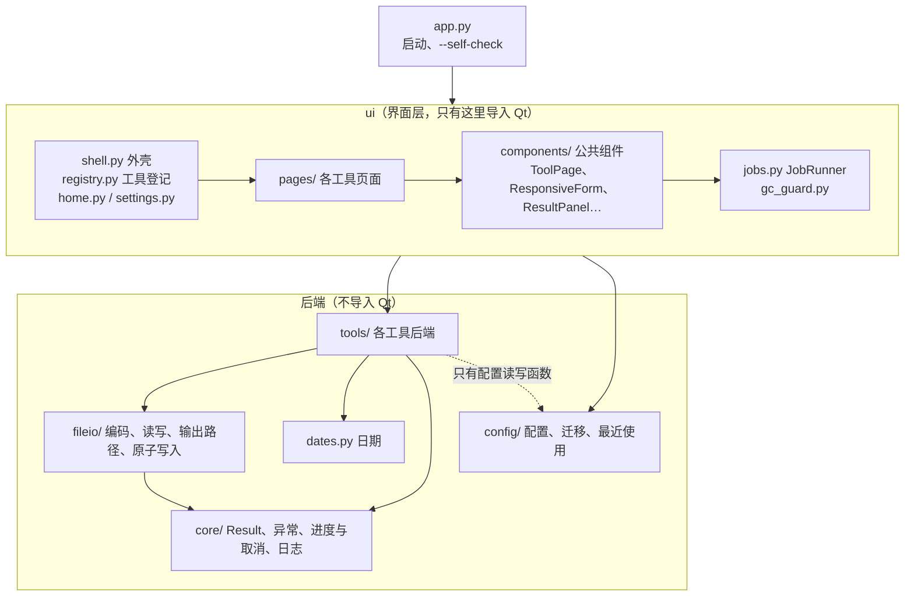

# DataForge Studio 开发文档

适用版本：3.0.0。

本文写给维护这个 Python 版、以及以后用 C# / Rust 重写的开发者。给编码代理的硬性规则见仓库根目录的 [AGENTS.md](../AGENTS.md)；后端接口见 [API 文档](API文档.md)；界面写法见 [界面规范](UI界面规范.md)；每个工具的业务规则只写在 [docs/tools/](tools/README.md) 下。

## 1. 开发环境

- Windows 10 / 11，Python 3.11 及以上（目前只在 3.13 上验证过；3.11 是 `pyproject.toml` 里 `requires-python` 声明的最低版本）。
- 在仓库根目录执行（PowerShell）：

```powershell
python -m venv .venv
.venv\Scripts\python -m pip install -r requirements-dev.txt
.venv\Scripts\python -m pip install -e .
.venv\Scripts\python -m dataforge
```

- `pip install -e .` 必须做：`python -m dataforge` 和 `build_onedir.ps1` 都依赖已安装的 `dataforge` 包。
- PySide6 限定为 `>=6.8,<6.11.3`。原因：6.11.3 起 Qt 的样式表渲染有回归，QFluentWidgets 的数字输入框（隐藏了上下按钮的 SpinBox）编辑区会被压成 1 像素宽，数值看不见。`tests/dataforge/test_spin_boxes.py` 会检查这一点；升级 PySide6 前先跑这个测试。
- 如果某个 venv 曾经升级到 PySide6 6.12，打包前先执行 `pip uninstall PySide6_WebEngine PySide6_Pdf` 清掉 6.12 遗留的包，或者重建 venv。
- 主要依赖：PySide6、PySide6-Fluent-Widgets（界面）、openpyxl（Excel 读写）、platformdirs（配置和日志目录）、darkdetect（跟随系统主题）、pywin32、pyautogui、pyperclip、keyboard、mouse（EDC）。完整列表见 `requirements.txt`。

## 2. 架构分层



分层规则：

- 后端（`core`、`fileio`、`config`、`dates.py`、`tools`）不导入 PySide6 / qfluentwidgets。这样规则可以脱离界面测试，也方便照着移植。`tests/dataforge/test_package.py` 会检查。
- 业务规则只写在 `tools/`。页面只负责收集输入、提交任务、显示结果。
- 工具入口不读应用配置。需要配置的工具（数据模糊化、EDC）由页面调用 `load_profile` / `load_config` 读出后作为参数传入。
- 编码识别、读写 CSV、输出命名、原子写入一律调用 `fileio`；日期一律调用 `dates.py`。

## 3. 目录说明

```
src/dataforge/
  __init__.py      __version__（版本号只写在这里）
  __main__.py      python -m dataforge 的入口
  app.py           创建 QApplication、主题、JobRunner、主窗口；处理 --self-check
  selfcheck.py     打包自检：导入全部页面模块和 EDC 依赖
  dates.py         日期解析和标准化
  core/            result.py、errors.py、progress.py、logs.py
  fileio/          encoding.py、text_io.py、paths.py、atomic.py
  config/          store.py（ConfigStore）、legacy.py（v2 迁移）、recent.py（最近使用）
  tools/           format_convert.py、sheet_split.py、field_extract.py、
                   date_convert.py、width_convert.py、
                   masking/（profile、scan、execute、table）、
                   edc/（config、loop、windows、live）
  ui/
    shell.py       FluentWindow 外壳、侧边栏、页面延迟加载、关闭确认
    registry.py    TOOLS：全部工具的登记表
    home.py        主页（最近使用 + 工具卡片）
    settings.py    设置页
    theme.py       主题切换、跟随系统
    layout.py      宽 / 中 / 窄三档断点
    jobs.py        JobRunner：全局唯一的后台任务运行器
    gc_guard.py    MainThreadGarbageCollector
    resources.py   图标路径
    components/    ToolPage、ResponsiveForm、ResultPanel、RunBar、FileInputCard、
                   FolderPicker、OutputLocationField、EncodingField、编码选择对话框等
    pages/         各工具页面；masking/ 和 edc/ 页面较复杂，各占一个子包

tests/
  dataforge/       单元测试、页面测试、冒烟测试（test_<主题>.py）
  golden/          标准样例：<tool_id>/<case>/
scripts/           capture_screenshots.py（README 截图）
packaging/         PyInstaller 配置、Inno Setup 脚本、构建脚本
docs/tools/        各工具的规则说明
assets/icons/      favicon.ico（程序图标，ui/resources.py 和安装包脚本都读它）
```

## 4. 新增一个工具

以文件类工具为例，按下面的顺序做。每一步都可以参照现有的"工作表拆分"（最简单）或"格式转换"（带编码重跑）。

1. **后端模块**：新建 `src/dataforge/tools/<tool_id>.py`。
   - 定义 options dataclass，默认值只写在这里；
   - 入口 `run(files, options, progress, cancel) -> Result`，签名和约定见 [API 文档的"通用约定"](API文档.md#通用约定)；
   - 非法输入抛 `DataForgeError`；单个文件出错用 `result.fail()` 记下后继续；每个文件开始前调用 `cancel.raise_if_cancelled()`；
   - 读写文件用 `fileio`，输出路径用 `plan_output`，日期用 `dates`。
2. **Result**：确定这个工具往 `stats` 里写哪些计数、哪些情况记警告、是否需要 `data`。CSV 编码有歧义时调用 `result.ask_encoding()` 并跳过该文件。
3. **页面**：新建 `src/dataforge/ui/pages/<tool_id>_page.py`，类名 `<ToolName>Page`，继承 `ToolPage`。
   - 构造函数签名 `(spec, runner, parent=None)`；如果需要读写配置，类属性设 `USES_CONFIG = True`，外壳会多传一个 `config=ConfigStore`；
   - 用 `add_section(标题, 控件)` 放输入卡片和参数卡片，参数表单用 `ResponsiveForm`；
   - 实现 5 个钩子：`build_job()`（读控件、构造 options、返回任务函数；输入不全时用 InfoBar 提示并返回 `None`）、`capture_state()` / `restore_state()`（"最近使用"保存和恢复的内容，必须能转成 JSON）、`summary()`（最近使用里显示的输入摘要）、`set_inputs_locked()`；
   - 支持编码重跑时再实现 `build_retry_job(encodings)`。
4. **登记**：在 `ui/registry.py` 的 `TOOLS` 中加一条 `ToolSpec(id, name, description, group, icon, page)`。主页卡片、侧边栏、页面标题都由它生成。`page` 写成 `"模块路径:类名"`，页面按需导入，所以模块必须能被 `selfcheck.py` 导入（它会遍历 `TOOLS`）。
5. **规则说明**：按 [docs/tools/README.md](tools/README.md) 的模板写 `docs/tools/<tool_id>.md`，在 README 的工具一览中加一行链接。
6. **标准样例**：
   - 新建 `tests/golden/<tool_id>/<case>/`（`params.json`、`input/`、`expected/`），期望输出用手写字面值，二进制文件用 `tests/golden/<tool_id>/make_fixtures.py`（放在工具目录下，一个工具一份）生成；
   - 在 `tests/dataforge/golden.py` 的 `ADAPTERS` 中加一个适配函数，把 `params.json` 转成 options 并运行；
   - 在 `tests/dataforge/test_golden.py` 中加一个"该工具有样例"的测试；
   - 在 `docs/tools/README.md` 的 `params.json` 键表里补上新键。
7. **测试**：后端测试 `tests/dataforge/test_<tool_id>.py`；页面测试 `tests/dataforge/test_<tool_id>_page.py`。`test_shell_smoke.py` 会在亮色、暗色主题下打开所有页面。

即时工具（例如日期转换）不需要后台任务，页面直接继承 `QWidget`，左右两个文本框，加"转换"和"复制结果"两个按钮，不写入"最近使用"。

## 5. 后台任务

### 5.1 JobRunner

- `ui/jobs.py` 的 `JobRunner` 全局只有一个，由 `app.py` 创建，传给每个页面。同一时间只运行一个任务。原因：EDC 会实际控制鼠标和键盘，不能和其他任务并行。
- 任务函数类型是 `JobFn = Callable[[ProgressFn, CancelToken], Result]`。`submit(tool_id, fn)` 在已有任务运行或程序正在退出时返回 `False`，不排队。
- 每个任务在一个 `QThread` 中运行。工作线程只发信号；信号以排队连接回到主线程，`JobRunner` 再发出 `started`、`progress`、`log`、`finished`、`failed`、`cancelled`、`busy_changed`。
- 异常的处理：`Cancelled` → `cancelled`；`DataForgeError` → `failed`，消息原样给用户；其他异常 → 写日志并 `failed`（"内部错误：…"）。
- 运行期间，`dataforge` logger 的日志会同步转发到当前页面的"日志"标签页。
- 退出时 `shutdown()` 先取消任务并最多等 5 秒；还没结束的线程会被保留到结束（不能销毁正在运行的 `QThread`），`app.py` 再最多等 3 秒，仍未结束就强制退出进程。
- 页面不得自己创建线程或 `QThread`，也不得在任务函数里创建 QObject、操作控件。

### 5.2 ToolPage 的运行流程

- 点主按钮 → `current_job_kind()` 决定任务类型 → `build_job()` → `submit_job(fn, kind)`。任务开始时锁定输入（`set_inputs_locked(True)`），并记下 `summary()` 和 `capture_state()`，成功后用它写入"最近使用"。
- 其他页面的任务在运行时，本页的主按钮不可用，并显示"<工具名> 正在运行"。
- 结束后 `_complete()` 把 `Result` 显示到结果区，并按结果用 InfoBar 提示（成功、部分失败、未生成文件、失败）。

### 5.3 辅助任务

扫描、EDC 的分段这类"不是主操作"的工作也走同一个 `JobRunner`，作为辅助任务提交：

- `current_job_kind()` 返回非 `"run"` 的值（数据模糊化扫描时返回 `"scan"`；EDC 的每一段都是辅助任务，返回 `"edc"`，由页面在 `on_aux_finished` 里决定是否续跑下一段）；
- 辅助任务成功后不走 `_complete()`，而是调用 `on_aux_finished(kind, result)`；
- 这个钩子运行时 runner 仍处于忙碌状态（工作线程结束后才释放），所以要接着提交下一个任务只能用 `submit_job_when_idle(fn, kind)`，它会等 runner 空闲后再提交；
- `keep_log_for_next_start(separator)` 让下一个任务开始时保留结果区，只在日志里加一行分隔，例如 EDC 的"—— 从 A12 继续 ——"。

### 5.4 编码重跑

1. 第一次运行时，编码有歧义的文件进入 `Result.encoding_questions`。
2. 页面实现了 `build_retry_job()` 时，`ToolPage` 先显示第一次的结果，再逐个弹出编码选择对话框（可勾选"本批其余文件也用此编码"）。
3. 用户取消的文件记一条"未选择编码，已跳过"。
4. 选了编码的文件交给 `build_retry_job(encodings)` 生成的任务重新处理，运行期间第一次的结果由 `carried_result()` 保存。
5. `RETRY_MERGES = True`（默认）时把两次结果合并显示；获取字段设为 `False`，因为它的重跑会生成一份完整的新汇总，只显示重跑的结果。

数据模糊化的扫描不走这条路：选完编码后整批重新扫描，因为"有且只有一个 DM.csv"这类检查涉及全部文件。

### 5.5 主线程 GC

- `app.py` 启动时创建 `MainThreadGarbageCollector`（`ui/gc_guard.py`）并调用 `start()`：关闭 Python 的自动垃圾回收，改由主线程上每秒一次的定时器按代检查并回收。
- 原因：自动回收会在恰好跨过分配阈值的线程上执行。如果这个线程是工作线程，它会在工作线程上销毁已经无人引用的 Qt 对象（定时器、动画、滚动引擎），而主线程同时在驱动动画，结果是堆损坏、程序崩溃。
- 因此：任务函数里不得调用 `gc.collect()`；每个 QObject 都要有父对象，或者显式 `deleteLater()`；每次用完的模态对话框在 `exec()` 返回后 `deleteLater()`。
- 程序退出时自动回收保持关闭，避免还在运行的工作线程触发回收。

## 6. 配置与迁移

- `config/store.py` 的 `ConfigStore` 读写一个 JSON 文件，按 section 存储：
  - `section(name)` 返回该节的深拷贝，没有时返回 `{}`；
  - `update_section(name, data)` 只替换这一节，其他节原样保留；先写同目录临时文件再替换，失败时返回 `False` 并写日志。
- 文件位置：`platformdirs.user_config_dir("dataforge_studio", appauthor=False, roaming=False)` 下的 `dataforge_studio_config.json`，一般是 `%LOCALAPPDATA%\dataforge_studio\`。环境变量 `DATAFORGE_STUDIO_CONFIG_PATH`（或旧的 `TOOLS_BOX_CONFIG_PATH`）可以指定别的文件。测试和截图脚本都用临时配置。
- 文件损坏（不是合法 JSON）时，先备份为 `<文件名>.corrupt-<时间>.bak`，再用默认值继续。这样下一次保存不会把其他工具的配置冲掉。
- 现有的 section：

| section | 内容 | 读写位置 |
| --- | --- | --- |
| `app` | `theme`：`auto` / `light` / `dark` | `ui/settings.py`、`app.py` |
| `recent` | 最近使用，最多 10 条 | `config/recent.py` |
| `data_masking_pattern1` | 数据模糊化配置 | `tools/masking/profile.py` |
| `edc_site_adder` | EDC 点击位置、行数上限、间隔、目标窗口 | `tools/edc/config.py` |

- v2 迁移：
  - 新配置文件还不存在时，`ConfigStore` 改为读取早期版本（1.x）使用的配置文件（`%LOCALAPPDATA%\tools_box\tools_box_config.json`），只读不改；第一次保存时写到新位置。2.x 已经使用 `dataforge_studio_config.json`，位置没变。section 名沿用，所以大部分配置直接可用。
  - 各工具的迁移统一调用 `config/legacy.py` 的 `load_section_with_legacy(store, section, legacy_keys, legacy_files)`：本节有内容时直接返回；否则如果配置根层直接有这个工具的键（v2 更早的版本把单个工具的配置写在根层），返回整个根；再否则依次读取 v2 的单独配置文件，找到后写入本节。不修改任何旧文件。
  - `legacy_file_candidates(file_name, *extra_dirs)` 列出 v2 单独配置文件可能的位置（打包后的程序目录、源码目录等），按优先级排列。
  - v2 的 section 名和旧文件名不能改，否则同事升级后要重新配置。
- 已废弃的配置项读取时忽略、保存时不写：数据模糊化的 `subject_sort`、`date_output_format`、`partial_date_policy`，EDC 的 `retry_count`。
- 修改配置结构要向后兼容：新增键给默认值，旧配置照样能读。

## 7. 主题

- 默认 `Theme.AUTO`，跟随系统；设置页可选"跟随系统 / 浅色 / 深色"，保存在 `app.theme`。
- 切换统一调用 `dataforge.ui.theme.apply_theme_mode(mode)`。
- 跟随系统：`start_system_theme_listener` 在一个守护线程里运行 `darkdetect.listener`，系统主题变化时只发信号，由主线程重新应用主题。
- 主窗口开启 Mica 效果，文件对话框使用系统原生对话框。
- 界面写法的完整规则见 [界面规范](UI界面规范.md)。

## 8. 测试与标准样例

```powershell
# 全部测试
.venv\Scripts\python -m pytest tests -q

# 单个文件
.venv\Scripts\python -m pytest tests/dataforge/test_format_convert.py -q
```

- 测试用 `unittest.TestCase` 风格编写，由 pytest 运行。
- Qt 测试由 `tests/dataforge/__init__.py` 设为 offscreen，不弹窗口；用 `tests/dataforge/qt_helpers.py` 的 `qapp()` 取得 QApplication。
- 测试中不导入 pyautogui、keyboard、mouse，不操作真实的鼠标、键盘、剪贴板或 Excel；EDC 用 `tests/dataforge/edc_fakes.py` 的假实现。唯一例外是 `test_selfcheck.py`，它在子进程里检查这些库能否导入。
- IO 测试用临时目录，断言具体的输出内容。
- 标准样例：`tests/golden/<tool_id>/<case>/`，由 `test_golden.py` 逐个运行并对照，比较规则和 `params.json` 的键见 [docs/tools/README.md](tools/README.md#标准样例)。
  - 期望输出必须是手写的字面值，不得用被测代码生成，否则样例只能证明"代码和自己一致"；
  - 数据模糊化的样例数据必须是虚构的；
  - 改任何工具的行为，要在同一次提交里同步修改规则说明和标准样例。
- `test_release.py` 检查版本号一致、依赖清单、打包配置，以及文档中有没有残留 v2 的内容。
- README 截图：`.venv\Scripts\python scripts\capture_screenshots.py`，必须在真实桌面上运行，会短暂打开窗口，使用临时配置。

## 9. 打包与自检

```powershell
# 生成 dist\DataForgeStudio\DataForgeStudio.exe，并自动运行自检
powershell -ExecutionPolicy Bypass -File .\packaging\scripts\build_onedir.ps1 -Clean

# 生成 dist_installer\DataForgeStudio-Setup-<版本>.exe（需要 Inno Setup 6）
powershell -ExecutionPolicy Bypass -File .\packaging\scripts\build_installer.ps1 -Clean
```

- 版本号写在 `src/dataforge/__init__.py` 的 `__version__`，安装脚本从这里读取。改版本时同时改 `pyproject.toml` 的 `version`、在 `CHANGELOG.md` 加 `## [<版本>]` 一节，并更新 `tests/dataforge/test_release.py` 和 `tests/dataforge/test_package.py` 中写死的版本号（这两个测试把上面几处分别与该版本号比较）。
- 自检：`DataForgeStudio.exe --self-check`（开发环境：`.venv\Scripts\python -m dataforge --self-check`）。工具页面是延迟导入的，PyInstaller 分析不到；自检会导入 `TOOLS` 中的全部页面模块和 EDC 用到的库，发现漏打包的模块。不开窗口，结果写到日志目录的 `self_check.txt`（通过时内容为 `OK`），退出码 0 表示通过。
- 新增依赖或页面后，先跑一次 `build_onedir.ps1`，确认自检通过。
- 参数、产物和覆盖安装的细节见 [packaging/README.md](../packaging/README.md)。

## 10. 日志

- `core/logs.py` 的 `setup_logging()` 给 `dataforge` logger 加一个滚动文件处理器：`platformdirs.user_log_dir("dataforge_studio", appauthor=False)` 下的 `dataforge.log`，单个文件 1 MB，保留 3 个备份。日志目录由 `default_log_dir()` 给出，自检结果 `self_check.txt`、设置页的"打开日志文件夹"和 `build_onedir.ps1` 都用它。
- 后端一律用 `logging.getLogger(__name__)`，不用 `print`。读取每个文本文件时都会记一条日志，写明所用编码和来源（自动识别 / 手动指定）。
